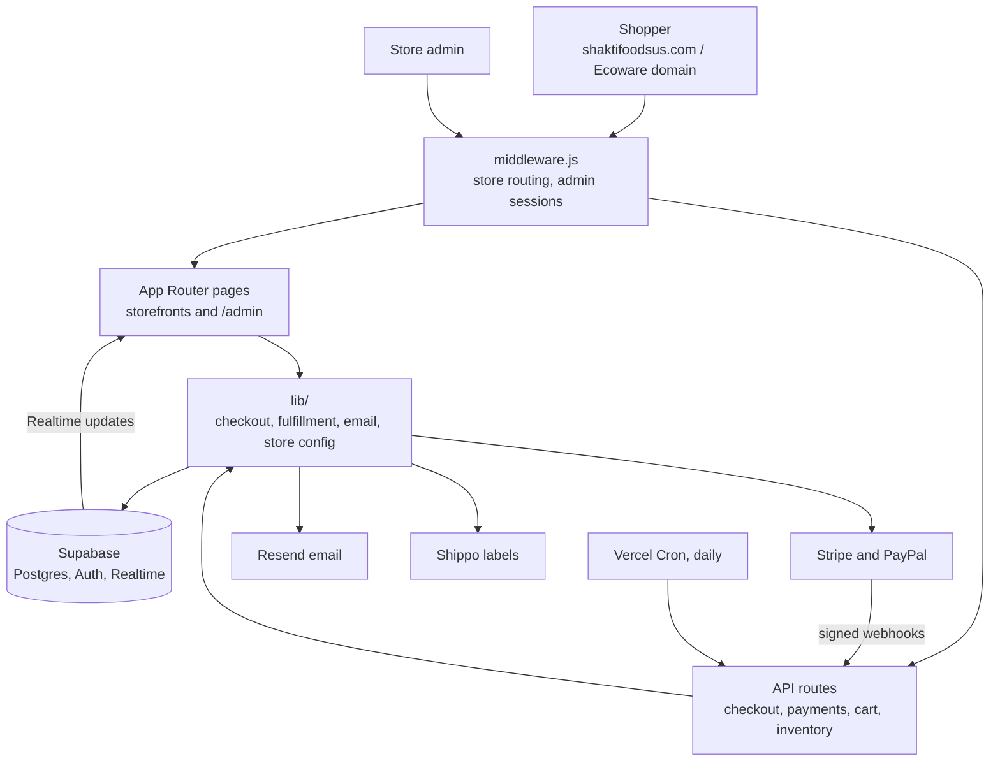
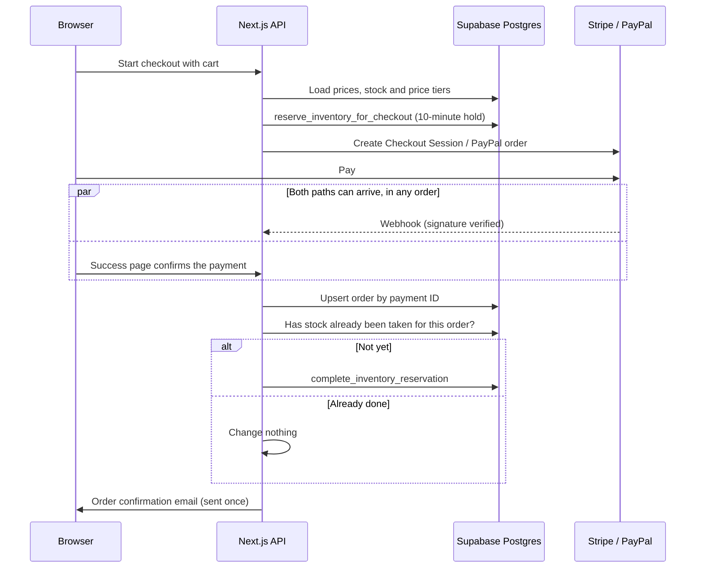

# Shakti Foods

A production e-commerce platform that runs two brands from one Next.js codebase:

- **Shakti Foods**: premium basmati rice, live at [shaktifoodsus.com](https://shaktifoodsus.com)
  (the older shakti-foods.com addresses forward there)
- **Simpli Ecoware**: compostable food-service products, live at [simpliecoware.vercel.app](https://simpliecoware.vercel.app)

It covers everything from browsing to delivery: the storefront, cart, Stripe and PayPal checkout,
inventory, order fulfillment, shipping labels, subscriptions, wholesale quotes, customer emails, and
an admin dashboard for running both stores.

**Stack:** Next.js 14 (App Router) · React · Tailwind CSS · Supabase (PostgreSQL, Auth, Realtime) ·
Stripe · PayPal · Resend · Shippo · Vercel (hosting and cron)

## Highlights

- **Each order is fulfilled exactly once.** Stock is reserved before the customer pays, and
  fulfillment is idempotent. A retried webhook, a refreshed success page or a second tab can't
  record the sale twice or take the stock twice. [How it works](#how-an-order-is-fulfilled-exactly-once)
- **Prices come from the database, not the browser.** The server rebuilds every cart from the
  product, inventory and volume-pricing tables before it creates a payment. It also checks that the
  payment provider's totals match before it fulfills.
- **Two brands, one codebase.** Middleware serves the Ecoware pages on the Ecoware domain. Each order
  records its store, and that decides the Stripe account, the email sender, and the links and
  redirects the customer sees.
- **Verified payment events.** Stripe webhooks are checked with each account's signing secret.
  PayPal webhooks are checked with PayPal's signature-verification API, and PayPal captures send an
  idempotency key (`PayPal-Request-Id`).
- **Recovery built in.** Expired checkouts release their reserved stock. A daily cron job sends
  abandoned-cart reminders and retries failed order confirmation emails (up to 5 attempts within
  7 days).
- **Live admin dashboard.** Supabase Realtime refreshes it when orders or inventory change.

## Architecture



## How an order is fulfilled exactly once

Payment providers retry webhooks, and customers refresh pages or pay in a second tab. The checkout
is built so that none of these can record a sale twice.



1. **Reserve.** `lib/checkout/prepare-checkout.js` loads prices, stock and price tiers from the
   database, works out the totals on the server, and calls `reserve_inventory_for_checkout`, which
   holds the stock for 10 minutes.
2. **Confirm.** The signed webhook and the success page both call the same code in
   `lib/fulfill-checkout.js`. Whichever arrives first does the work.
3. **Stay idempotent.** The order is upserted by its Stripe Checkout Session ID (or PayPal order
   ID). The reservation must match the one created at checkout. Stock is only taken if no `sale`
   transaction exists for that order yet.
4. **Release.** If the Checkout Session expires or the payment fails, `release_inventory_reservation`
   puts the stock back.
5. **Email once.** Each order records its confirmation status. A send that runs at the same time
   as another never marks a delivered email as failed, and the daily cron retries real failures.

## Features

### Storefront

- Product catalog with search, collections, image galleries, specifications, certifications and
  customer reviews
- Volume pricing tiers, with the cart checked against live stock
- Stripe Checkout (cards, with optional Stripe Tax) and PayPal
- Subscriptions with Stripe and PayPal, including payment-failure recovery
- Abandoned-cart reminder emails with a link that restores the cart
- Wholesale inquiry forms on both stores. Ecoware also has product sample requests, a quote
  request page and a sustainability page.
- Sitemap, robots.txt and Google Analytics

### Admin dashboard (`/admin`)

- Supabase Auth login. Admin access comes from the user's role or an `ADMIN_EMAILS` allow-list.
- A store switcher for Shakti Foods and Simpli Ecoware
- Overview with stats, recent orders and low-stock products, updated live
- Orders: fulfillment status, Shippo shipping rates and label purchase, wholesale payments
- Products: create and edit, images, certifications and categories
- Inventory: manual adjustments with a full history
- Customers: addresses, documents and an activity log
- Wholesale: inquiry → quote → customer accepts or declines → order
- Review moderation, sample requests and subscription management
- Email check: shows the live Resend setup and sends a test confirmation for either store

## Project map

```text
app/(storefront)/               Shakti Foods pages
app/ecoware/                    Simpli Ecoware pages (served on the Ecoware domain)
app/admin/                      Admin dashboard ([storefront]/ holds the per-store views)
app/api/                        Checkout, payments, webhooks, cart, inventory, cron, wholesale
lib/checkout/prepare-checkout.js   Server-side pricing and stock reservation
lib/fulfill-checkout.js            Idempotent fulfillment for Stripe and PayPal
lib/stripe-storefront.js           Picks the Stripe account for each store
lib/storefront-config.js           Brand, domain and email sender for each store
lib/paypal.js                      PayPal orders, captures and subscriptions
lib/subscriptions/                 Subscription checkout and renewals
lib/cart-recovery-processor.js     Abandoned-cart reminder emails
lib/order-confirmation-email.js    Confirmation emails, status tracking and retries
lib/shippo.js                      Shipping rates and labels
middleware.js                      Domain routing and admin sessions
vercel.json                        Daily cron schedule
supabase/migrations/               Database migrations
```

## Database

The data lives in Supabase Postgres. The main tables are `products`, `product_price_tiers`,
`inventory`, `inventory_transactions`, `checkout_reservations`, `orders`, `order_items`,
`customers`, `customer_addresses`, `subscriptions`, `wholesale_inquiries`, `wholesale_quotes`,
`product_reviews`, `sample_requests` and `cart_recovery_sessions`.

Stock changes run inside Postgres functions called through Supabase RPC, so each one happens in a
single transaction: `reserve_inventory_for_checkout`, `complete_inventory_reservation`,
`release_inventory_reservation` and `adjust_inventory_stock`. Subscription renewals use
`fulfill_recurring_subscription_payment` and `fulfill_stripe_subscription_invoice`.

## Running locally

You need Node.js 18.17 or later, a Supabase project with the schema above, Stripe test keys and a Resend API key.
A PayPal sandbox app is optional.

```bash
npm install
cp .env.example .env.local    # then fill in the values below
npm run dev
```

Shakti Foods opens at `http://localhost:3000`, and Ecoware at `http://localhost:3000/ecoware`.

To receive Stripe webhooks locally, use the Stripe CLI:

```bash
stripe listen --forward-to localhost:3000/api/stripe/webhook
```

Put the signing secret it prints in `SHAKTI_STRIPE_WEBHOOK_SECRET` (or `STRIPE_WEBHOOK_SECRET`
when testing with the Ecoware account).

Pay with the test card `4242 4242 4242 4242`, any future expiry date, any CVC and any ZIP code.

### Environment variables

| Area | Variables |
| --- | --- |
| Sites | `NEXT_PUBLIC_BASE_URL`, `NEXT_PUBLIC_SITE_URL`, `NEXT_PUBLIC_ECOWARE_URL` |
| Supabase | `NEXT_PUBLIC_SUPABASE_URL`, `NEXT_PUBLIC_SUPABASE_ANON_KEY`, `SUPABASE_SERVICE_ROLE_KEY` |
| Stripe (Shakti Foods) | `SHAKTI_STRIPE_SECRET_KEY`, `SHAKTI_STRIPE_WEBHOOK_SECRET` |
| Stripe (Ecoware) | `STRIPE_SECRET_KEY`, `STRIPE_WEBHOOK_SECRET`, `STRIPE_AUTOMATIC_TAX` |
| PayPal | `PAYPAL_CLIENT_ID`, `PAYPAL_CLIENT_SECRET`, `PAYPAL_WEBHOOK_ID`, `NEXT_PUBLIC_PAYPAL_CLIENT_ID`, `PAYPAL_ENVIRONMENT`, `PAYPAL_LIVE_ENABLED`, `NEXT_PUBLIC_PAYPAL_LIVE_ENABLED` |
| Email | `RESEND_API_KEY`, `ORDER_EMAIL_FROM`, `SHAKTI_ORDER_EMAIL_FROM`, `ECOWARE_ORDER_EMAIL_FROM`, `SHAKTI_SUPPORT_EMAIL`, `ECOWARE_SUPPORT_EMAIL`, `ECOWARE_SUPPORT_PHONE` |
| Wholesale inquiry email (SMTP) | `SMTP_HOST`, `SMTP_PORT`, `SMTP_USER`, `SMTP_PASS`, `SMTP_FROM`, `INQUIRY_TO` |
| Admin, cron, shipping | `ADMIN_EMAILS`, `CRON_SECRET`, `SHIPPO_API_TOKEN` |
| Feature flags | `SUBSCRIPTIONS_LIVE_ENABLED`, `NEXT_PUBLIC_SUBSCRIPTIONS_LIVE_ENABLED` |
| Analytics | `NEXT_PUBLIC_GA_MEASUREMENT_ID` |

On production, PayPal stays off unless `PAYPAL_ENVIRONMENT=live`, `PAYPAL_LIVE_ENABLED=true` and
`NEXT_PUBLIC_PAYPAL_LIVE_ENABLED=true` are all set. Preview deployments and local development
keep PayPal available for sandbox testing.

Deployment, email and PayPal setup notes are in [docs/operations.md](docs/operations.md).

## Next steps

- Move the codebase to TypeScript
- Add automated tests for checkout, fulfillment and webhook handling
- Keep the full database schema in `supabase/migrations/`
